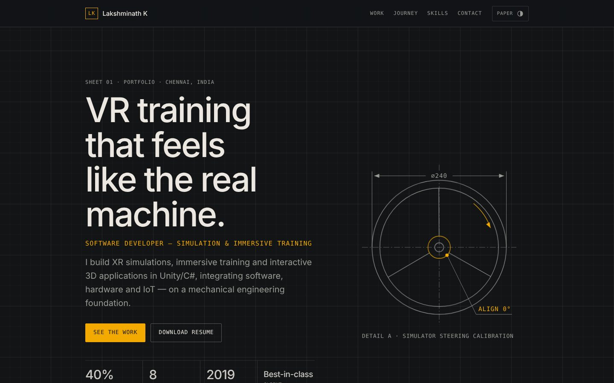

# Lakshminath K — Portfolio

**Software Developer — Simulation & Immersive Training** · Chennai, India

**Live:** https://lakshminath-k.vercel.app · **Resume:** [resume.pdf](https://lakshminath-k.vercel.app/resume.pdf)



## What this is

Personal portfolio of Lakshminath K, a software developer building simulation and immersive training applications.

- The flagship VR forklift simulator is presented as a case study (challenge, role, outcome, stack), followed by shorter project cards.
- Most of the work shown is client-owned, so the projects are described rather than linked to source code.
- The visual style, "Engineering Drawing, Dark Edition", draws on a mechanical design background: project cards are styled as drawing sheets with title blocks.

## Highlights shown on the site

| | |
|---|---|
| Flagship | VR forklift training simulator with a custom real-time simulator rig and rig-to-VR calibration (Unity, C#, Meta Quest 3, OpenXR, ESP32, REST APIs, Supabase) |
| VR training | Pump maintenance (assembly, disassembly, inspection) and hardware-assisted fire-safety training |
| Integration | Training analytics dashboard tracking trainee progress, completion and evaluation |
| Automation | C# / NX Open CAD automation tool: **40% design-efficiency gain** |
| Leadership | Leads an 8-member cross-functional software + hardware team |

## Tech and design decisions

- **Plain HTML, CSS and JavaScript.** No framework and no build step. The page has no runtime dependencies besides Google Fonts, so it loads fast and there's almost nothing to break or maintain.
- **Deployed on Vercel** from `main`. Every push redeploys within a minute.
- **Accessible by default:** semantic sections, keyboard-usable filters and toggles, visible focus states, and `prefers-reduced-motion` respected.
- **Responsive from 360 px up**, plus a light "drawing paper" theme that is remembered per visitor.
- **Small touches:** click-to-copy email, project filters, an "Engineer's lens" on each card, and a scroll-driven mechanical → software meter on the timeline.

## Project structure

```
index.html        content and sections (Hero, Work, Journey, Skills & awards, Contact)
styles.css        design tokens (CSS variables) and layout
script.js         reveals, journey meter, filters, lens toggles, copy email, theme, image loading
resume.pdf        downloadable resume
assets/work/      project images, picked up automatically by file name
assets/screenshot.jpg
```

## Run locally

```bash
git clone https://github.com/Lakshminath97/portfolio-site.git
cd portfolio-site
python3 -m http.server 8000   # then open http://localhost:8000
```

## Updating content

- **Text:** edit `index.html`. Each section is marked with a comment banner.
- **Project images:** upload to `assets/work/` with the card's file name (`forklift.jpg`, `pump-vr.jpg`, `fire-safety.jpg`, `lms.jpg`, `cad-automation.jpg`, `biw-fixture.jpg`, `hvac.jpg`, `point-cloud.jpg`). No code changes are needed. See `assets/README.md`.
- **Resume:** replace `resume.pdf` in the repo root.

## Contact

[LinkedIn](https://www.linkedin.com/in/lakshminath-k-1609lk450) · [Email](mailto:lakshminath.1997@gmail.com) · [Portfolio](https://lakshminath-k.vercel.app)
